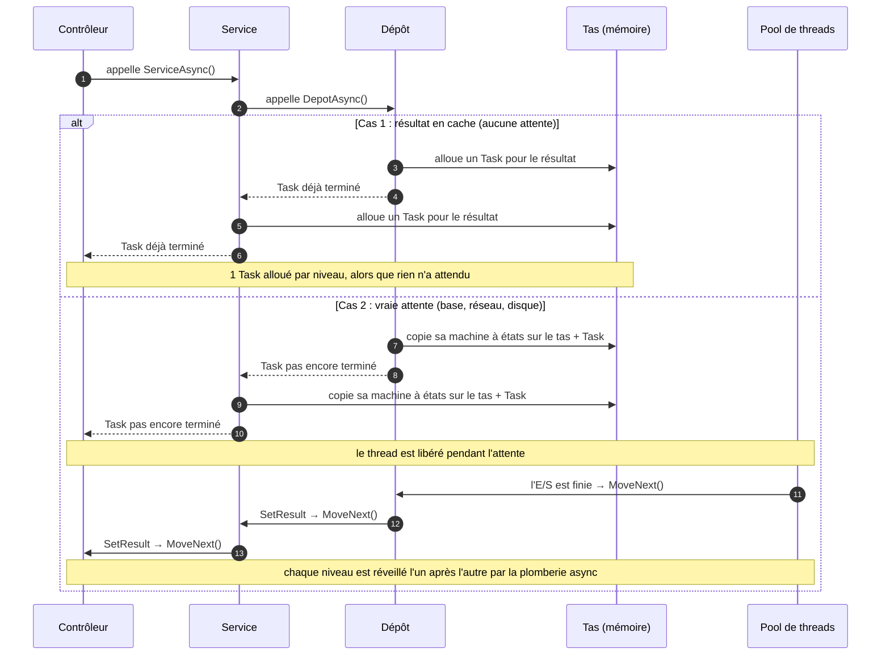
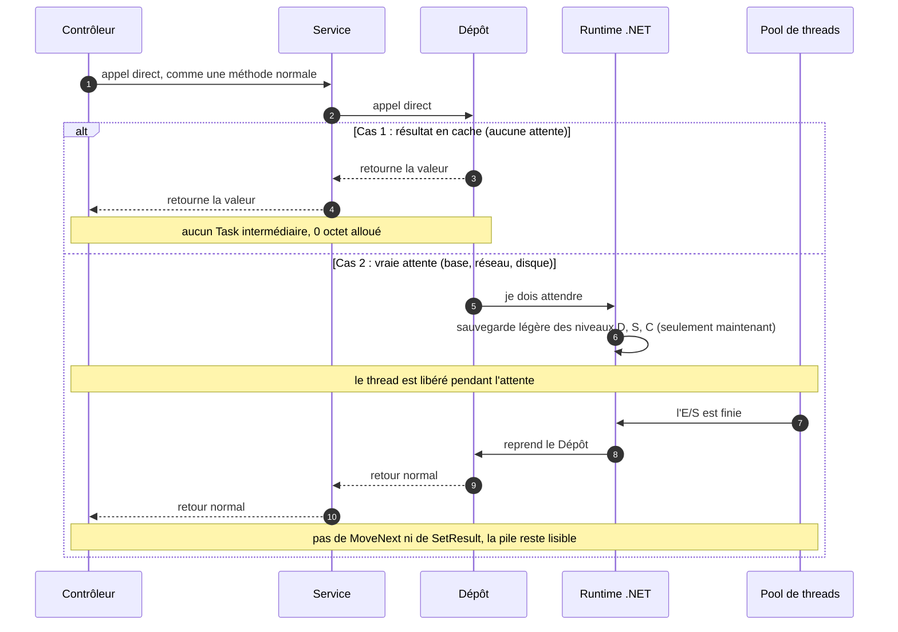
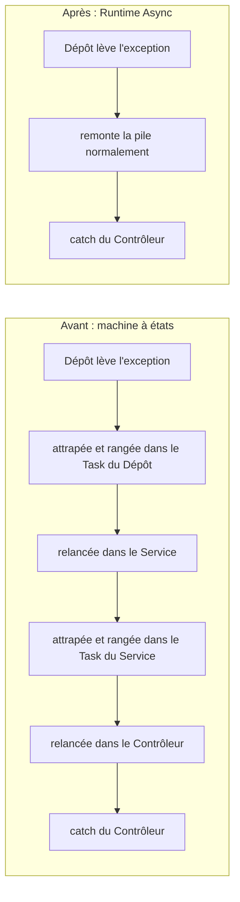

# RuntimeAsyncDemo — Runtime Async dans .NET 11

Le **même code C#** est compilé de deux façons, puis comparé :

| Mode | Réglage | Ce qui est produit |
|---|---|---|
| **Classique** (avant .NET 11) | `-p:AsyncMode=compiler` | Le compilateur transforme chaque méthode `async` en *machine à états* |
| **Runtime Async** (.NET 11) | `-p:AsyncMode=runtime` (par défaut ici) | La méthode reste une méthode normale marquée « async », gérée par le runtime |

Testé avec le SDK `11.0.100-rc.3` (épinglé dans `global.json`).

---

## 1. L'asynchronisme expliqué simplement

### L'image du restaurant

Un serveur (un **thread**) prend une commande et la transmet en cuisine (une **base de données**, une **API**, un **disque**).

- **Code synchrone** : le serveur reste planté devant la cuisine jusqu'à ce que le plat soit prêt.
  Pendant ce temps, il ne sert personne. Pour servir 100 tables, il faut 100 serveurs.
- **Code asynchrone** : le serveur transmet la commande, note où il en est (« table 4, plat en cuisson »), puis
  va servir d'autres tables. Quand la cuisine sonne, **n'importe quel serveur libre** reprend la commande là où
  elle en était. Quelques serveurs suffisent pour des centaines de tables.

```csharp
public async Task<Commande> ChargerAsync(int id)
{
    var client = await _db.Clients.FindAsync(id);   // ① on lance la requête, le thread repart travailler ailleurs
                                                    // ② la base répond → un thread libre reprend ICI
    return new Commande(client);
}
```

`await` veut dire : **« je ne bloque personne en attendant ; reprends-moi quand c'est prêt »**.

### Trois idées fausses fréquentes

1. **« async rend le code plus rapide »** : faux pour *une* requête, qui prend autant de temps. Ce qui change,
   c'est le **nombre de requêtes simultanées** qu'un serveur supporte avec peu de threads.
2. **« async, c'est du parallélisme »** : non. `await` attend ; il ne lance rien en parallèle. Le parallélisme,
   c'est `Task.WhenAll`, `Parallel.ForEachAsync`…
3. **« Il faut async partout, même pour du calcul »** : non. L'async sert aux **attentes** (réseau, disque, base).
   Pour du calcul pur, il n'apporte que du coût.

### Le prix à payer : la « note » du serveur

Pour reprendre une méthode au milieu, il faut **sauvegarder où on en était** : la ligne, les variables locales, la
méthode appelante à prévenir… C'est cette mécanique que .NET 11 change.

> 📚 Pas à l'aise avec la notion de « pile » (*stack*), de cadre ou de *stack trace* ? La note
> [PILE.md](PILE.md) l'explique avec des schémas simples, jusqu'au lien avec l'async.

---

## 2. Comment ça marchait jusqu'ici : la machine à états

### C'est quoi, une machine à états ?

Un objet qui **se souvient de l'étape où il en est**, et qui sait quoi faire ensuite selon cette étape.
On en croise partout :

- **Un feu tricolore** : 3 états (vert, orange, rouge). À chaque « tic », il regarde son état actuel et passe au
  suivant. Il n'a besoin de retenir qu'une chose : sa couleur.
- **Un distributeur de boissons** : « attend une pièce » → « attend le choix » → « sert la boisson » → retour au début.
  Si on l'interrompt entre deux étapes, il sait exactement où reprendre.
- **Un marque-page** : on ferme le livre, on le reprend une semaine plus tard, et on repart à la bonne page.

En code, c'est simplement un entier `etat` et un `switch` :

```csharp
class FeuTricolore
{
    private int etat = 0;                 // 0 = vert, 1 = orange, 2 = rouge

    public void Tic()
    {
        switch (etat)
        {
            case 0: Console.WriteLine("Vert");   etat = 1; break;
            case 1: Console.WriteLine("Orange"); etat = 2; break;
            case 2: Console.WriteLine("Rouge");  etat = 0; break;
        }
    }
}
```

### Le lien avec async

Une méthode async doit pouvoir **s'arrêter au milieu** (à chaque `await`) puis **reprendre plus tard**, souvent sur un
autre thread. Or une méthode normale ne sait pas faire ça : quand elle rend la main, ses variables locales disparaissent.

Le compilateur découpe donc la méthode en morceaux, un par `await`, et en fait une machine à états :

```
async Task TraiterAsync()                     État -1 : début → lance ChargerClient
{                                                         si pas fini : etat = 0, on rend la main
    var c = await ChargerClientAsync();       État  0 : reprise → récupère c, lance CalculerPrix
    var p = await CalculerPrixAsync(c);                   si pas fini : etat = 1, on rend la main
    await EnregistrerAsync(p);                État  1 : reprise → récupère p, lance Enregistrer…
}                                             État  2 : reprise → terminé
```

Les variables locales (`c`, `p`) deviennent des **champs** de l'objet, pour survivre entre deux étapes. Chaque fois
qu'une attente se termine, quelqu'un appelle `MoveNext()`, qui fait un `switch (etat)` et reprend au bon morceau.
C'est le marque-page de la méthode.

### En détail

Le compilateur réécrit votre méthode. En simplifiant, `ChargerAsync` devient :

```csharp
// Généré par le compilateur (simplifié)
struct ChargerAsync_d__0 : IAsyncStateMachine
{
    public int etat;                               // « où j'en suis » : -1 = début, 0 = après le 1er await…
    public AsyncTaskMethodBuilder<Commande> builder;
    public int id;                                 // les variables locales deviennent des champs
    private TaskAwaiter<Client> attente;

    public void MoveNext()                          // appelée au début, puis à chaque reprise
    {
        try
        {
            if (etat == -1)
            {
                attente = _db.Clients.FindAsync(id).GetAwaiter();
                if (!attente.IsCompleted)
                {
                    etat = 0;
                    builder.AwaitUnsafeOnCompleted(ref attente, ref this); // copie la struct SUR LE TAS
                    return;                                                // rend la main
                }
            }
            var client = attente.GetResult();
            builder.SetResult(new Commande(client));                       // crée/complète un Task<Commande>
        }
        catch (Exception ex) { builder.SetException(ex); }                 // l'exception est RANGÉE dans le Task
    }
}
```

Conséquences :

- **Chaque niveau d'appel** crée sa machine à états, et souvent son propre `Task` : 5 méthodes async imbriquées,
  c'est 5 `Task` alloués, même quand rien n'attend vraiment (données en cache).
- **Une exception** est capturée dans le `Task` à chaque niveau, puis relancée au niveau du dessus
  (`ExceptionDispatchInfo.Throw`). Avec 10 niveaux, l'exception est attrapée et relancée 10 fois.
- **La pile d'appels** pendant l'exécution est pleine de `MoveNext`, `AsyncStateMachineBox`,
  `ExecutionContextCallback`… C'est ce que montrent le débogueur et les profileurs.

## 3. Ce que change Runtime Async (.NET 11)

Le compilateur **ne réécrit plus la méthode**. Il la marque simplement comme « async » dans l'IL
(`MethodImplAttributes.Async`, valeur `0x2000`), et c'est **le runtime (le JIT)** qui sait la suspendre et la reprendre.

| | Machine à états (avant) | Runtime Async (.NET 11) |
|---|---|---|
| Appel qui se termine tout de suite | Machine à états et `Task` créés à chaque niveau | Appel presque normal, pas de `Task` intermédiaire |
| Vraie attente (E/S) | La machine à états de chaque niveau est copiée sur le tas | Le runtime sauvegarde l'état seulement au moment où il faut vraiment suspendre |
| Exception | Rangée dans un `Task` puis relancée à chaque niveau | Remonte comme une exception normale |
| Pile vue au débogueur | Encombrée de plomberie | Proche du code écrit |
| Classes générées | Une par méthode async | Aucune |

**Rien ne change dans votre code** : mêmes `async`, `await`, `Task`. On recompile, c'est tout.

### Schéma : avant (machine à états)



### Schéma : après (Runtime Async, .NET 11)



### Schéma : une exception qui remonte



Avant, l'exception est attrapée puis relancée **à chaque niveau**. Après, elle remonte une seule fois, comme dans du
code synchrone. C'est pour ça qu'une exception sur 20 niveaux passe de 27 µs à 6 µs.

### Activer Runtime Async

```xml
<PropertyGroup>
  <TargetFramework>net11.0</TargetFramework>
  <Features>$(Features);runtime-async=on</Features>
</PropertyGroup>
```

> ⚠️ Vérifié sur le SDK RC3 : **sans ce réglage, votre code est toujours compilé avec la machine à états.**
> Les bibliothèques de .NET 11 elles-mêmes sont déjà compilées en Runtime Async. La documentation Microsoft classe
> encore la fonctionnalité en *preview* pour le code utilisateur.
>
> Piège rencontré : changer `Features` ne déclenche pas de recompilation incrémentale. Après un changement,
> faites un `dotnet build --no-incremental`. Cette solution évite le problème avec un dossier `artifacts\<mode>\` par mode.

Pour vérifier ce qui a vraiment été compilé (voir `ModeAsync.cs`) :

```csharp
var m = typeof(MonService).GetMethod("TraiterAsync")!;
bool runtimeAsync = ((int)m.MethodImplementationFlags & 0x2000) != 0;   // true = Runtime Async
```

---

## 4. Résultats mesurés

BenchmarkDotNet 0.16.0-preview.2, .NET 11.0.0-rc.3, AMD Ryzen 7 9800X3D, Windows 11, mesuré le 2026-11-09.
Même code, même runtime : seule la compilation des méthodes `async` change.

### Service métier : 1 000 commandes (4 niveaux d'async par commande)

| Scénario | Classique | Runtime Async | Gain |
|---|---:|---:|---|
| Tout en cache (aucune vraie attente) | 48,0 µs · 312 Ko alloués | **26,5 µs · 0 octet** | **1,8× plus rapide, zéro allocation** |
| Avec vraies attentes (3 suspensions par commande) | 742 µs · 607 Ko | **442 µs · 384 Ko** | **1,7× plus rapide, −37 % de mémoire** |

### Chaîne d'appels de profondeur N (contrôleur → service → dépôt → …)

| Profondeur | Sans attente : classique → runtime | Attente tout en bas : classique → runtime |
|---:|---|---|
| 1 | 18 ns · 144 o → **7 ns · 0 o** (×2,5) | 299 ns · 223 o → **215 ns · 192 o** (×1,4) |
| 5 | 48 ns · 432 o → **18 ns · 0 o** (×2,7) | 501 ns · 660 o → **276 ns · 448 o** (×1,8) |
| 20 | 238 ns · 1 512 o → **57 ns · 0 o** (×4,1) | 1 190 ns · 2 301 o → **604 ns · 1 408 o** (×2,0) |

### Exception métier qui remonte N niveaux

| Profondeur | Classique | Runtime Async | Gain |
|---:|---:|---:|---|
| 1 | 3,49 µs · 1 640 o | **1,37 µs · 464 o** | ×2,6 |
| 5 | 8,24 µs · 6 488 o | **2,43 µs · 760 o** | ×3,4 |
| 20 | 27,06 µs · 39 576 o | **6,20 µs · 2 376 o** | **×4,4 et 17× moins de mémoire** |

### Pile d'appels vivante (démo `RuntimeAsyncDemo.Demo`, section 1 bis)

Vue depuis la méthode la plus basse, après une attente :

```
Classique : 10 cadres                                     Runtime Async : 5 cadres
  ChaineAppels.BaseDeDonneesPileAsync()                     ChaineAppels.BaseDeDonneesPileAsync()
  AsyncStateMachineBox`1.ExecutionContextCallback(…)        ThreadPoolWorkQueue.Dispatch()
  ExecutionContext.RunFromThreadPoolDispatchLoop(…)         PortableThreadPool.WorkerThread.WorkerDoWork(…)
  AsyncStateMachineBox`1.MoveNext(…)                        PortableThreadPool.WorkerThread.WorkerThreadStart()
  AsyncStateMachineBox`1.MoveNext(…)                        Thread.StartCallback(…)
  AsyncStateMachineBox`1.ExecuteDirectly(…)
  ThreadPoolWorkQueue.Dispatch()
  … (3 cadres du pool de threads)
```

Les piles des **exceptions** (`ex.StackTrace`) sont, elles, identiques dans les deux modes, car .NET les nettoie déjà
depuis .NET Core 2.1. Le gain se voit dans le débogueur, les profileurs et les dumps.

### Comment lire ces chiffres

- **Le gain le plus fort concerne le cas le plus courant** : des appels async qui se terminent tout de suite (cache,
  données déjà en mémoire, tampon de flux). Avant, on payait un `Task` par niveau. Maintenant, on ne paie rien.
- **Plus la chaîne est profonde, plus on gagne** : les architectures en couches (contrôleur → service → dépôt →
  client HTTP) et les décorateurs (cache, retry, logging) en profitent directement.
- **Ce sont des gains sur la *mécanique* async, pas sur l'attente elle-même.** Une requête SQL de 2 ms reste une
  requête de 2 ms. Sur un appel isolé, 200 ns gagnées ne se voient pas. Sur un serveur qui traite des milliers de
  requêtes par seconde, chacune faisant des dizaines d'appels async, cela devient du CPU et du GC économisés,
  donc plus de requêtes par machine et des latences plus régulières.
- **Moins d'allocations, c'est moins de ramasse-miettes** : le service en cache passe de 312 Ko à 0 octet pour
  1 000 commandes. Le GC ne se déclenche plus du tout sur ce chemin.

---

## 5. Ce que le compilateur fait de votre code, côte à côte

Pour deux méthodes de la solution, voici ce qui se retrouve **réellement dans la DLL** dans chaque mode, réécrit en
C# lisible. Les appels ont été relevés dans l'IL des deux builds (SDK RC3). Les noms sont raccourcis et c'est du
pseudo-C# : le vrai code généré utilise des sauts (`goto`) qu'on ne peut pas écrire tels quels.

### Exemple 1 : une attente (`LireRemiseAsync`, dans `ServiceCommandes.cs`)

Ce que vous écrivez :

```csharp
private async Task<decimal> LireRemiseAsync(Client client)
{
    if (_simulerEntreesSorties) await Task.Yield();
    return client.Remise;
}
```

Ce que le compilateur produit :

<table>
<tr><th>Mode classique (machine à états)</th><th>Runtime Async (.NET 11)</th></tr>
<tr><td valign="top">

```csharp
// ① La méthode ne fait plus que
//   préparer la machine à états
Task<decimal> LireRemiseAsync(Client c)
{
  var m = new <LireRemiseAsync>d__9();
  m.client = c;
  m.etat = -1;
  m.builder = Builder<decimal>.Create();
  m.builder.Start(ref m); // → MoveNext
  return m.builder.Task;
}

// ② Votre code est déplacé ici,
//   découpé autour de l'await
struct <LireRemiseAsync>d__9
{
  void MoveNext()
  {
    try
    {
      if (etat == 0) goto Reprise;
      if (_simulerEntreesSorties)
      {
        attente = Task.Yield().GetAwaiter();
        if (!attente.IsCompleted)
        {
          etat = 0;
          builder.AwaitUnsafeOnCompleted(
            ref attente, ref this);
          return;        // suspendue
        }
      Reprise:
        attente.GetResult();
      }
      builder.SetResult(client.Remise);
    }
    catch (Exception e)
    {
      builder.SetException(e);
    }
  }
}
```

</td><td valign="top">

```csharp
// Une seule méthode, marquée « async »
// dans l'IL (drapeau 0x2000)
Task<decimal> LireRemiseAsync(Client c)
{
  if (_simulerEntreesSorties)
  {
    var att = Task.Yield().GetAwaiter();
    if (!att.IsCompleted)
      AsyncHelpers.UnsafeAwaitAwaiter(att);
      // ↑ le runtime suspend et
      //   reprend ICI
    att.GetResult();
  }
  return c.Remise;
  // ↑ valeur renvoyée directement :
  //   pas de SetResult, et pas de Task
  //   si l'appelant est lui aussi async
}
```

</td></tr>
<tr><td>

**2 méthodes + 1 type généré · 239 octets d'IL**<br>
Le JIT compile 4 méthodes.

</td><td>

**1 méthode · 51 octets d'IL**<br>
Le JIT compile 1 méthode.

</td></tr>
</table>

### Exemple 2 : une exception (`DescendreEtEchouerAsync`, dans `ChaineAppels.cs`)

Ce que vous écrivez :

```csharp
static async Task<int> DescendreEtEchouerAsync(int profondeur)
{
    if (profondeur == 0) throw new CommandeInvalideException("Quantité négative");
    return await DescendreEtEchouerAsync(profondeur - 1) + 1;
}
```

Ce que le compilateur produit (la partie « préparation » du mode classique est la même qu'à l'exemple 1) :

<table>
<tr><th>Mode classique (machine à états)</th><th>Runtime Async (.NET 11)</th></tr>
<tr><td valign="top">

```csharp
void MoveNext()
{
  try
  {
    if (etat == 0) goto Reprise;
    if (profondeur == 0)
      throw new CommandeInvalideException(…);
    attente = DescendreEtEchouerAsync(
      profondeur - 1).GetAwaiter();
    if (!attente.IsCompleted)
    {
      etat = 0;
      builder.AwaitUnsafeOnCompleted(…);
      return;
    }
  Reprise:
    // GetResult RELANCE l'exception
    // rangée par le niveau du dessous
    builder.SetResult(
      attente.GetResult() + 1);
  }
  catch (Exception e)
  {
    // …et on la RANGE dans le Task
    // de ce niveau
    builder.SetException(e);
  }
}
```

</td><td valign="top">

```csharp
Task<int> DescendreEtEchouerAsync(int p)
{
  if (p == 0)
    throw new CommandeInvalideException(…);

  return AsyncHelpers.Await(
    DescendreEtEchouerAsync(p - 1)) + 1;
}

// Aucun try/catch généré :
// l'exception remonte la pile une seule
// fois, comme dans du code synchrone.
```

</td></tr>
<tr><td>

**228 octets d'IL**<br>
À chaque niveau : attrapée, rangée, relancée.

</td><td>

**30 octets d'IL**<br>
Elle remonte directement jusqu'au `catch`.

</td></tr>
</table>

C'est ce qui explique les benchmarks de la section 4 : sur 20 niveaux, le mode classique attrape et relance
l'exception 20 fois (27 µs), contre une seule remontée en Runtime Async (6 µs).

### Pour aller plus loin

- **En ligne** : [SharpLab](https://sharplab.io) (vue *C#* : la machine à états apparaît en clair) ou
  [Compiler Explorer](https://godbolt.org). Ces deux sites tournent en .NET 10, donc en mode classique uniquement.
- **En local, avec .NET 11** : le runtime liste les méthodes que son JIT compile.
  ```powershell
  dotnet build -c Release src/RuntimeAsyncDemo.Demo -p:AsyncMode=runtime
  $env:DOTNET_JitDisasmSummary = "1"
  dotnet artifacts\runtime\bin\RuntimeAsyncDemo.Demo\Release\net11.0\RuntimeAsyncDemo.Demo.dll
  ```
  Pour `LireRemiseAsync`, on voit 4 méthodes compilées en mode classique (point d'entrée, 2 méthodes de démarrage,
  `MoveNext`) contre 1 seule en Runtime Async.

---

## 6. Lancer la solution

```bash
# Démo rapide (~30 s) : pile d'appels + mesures simples, dans les deux modes
./comparer.ps1

# Un seul mode
dotnet run -c Release --project src/RuntimeAsyncDemo.Demo -p:AsyncMode=compiler
dotnet run -c Release --project src/RuntimeAsyncDemo.Demo -p:AsyncMode=runtime

# Benchmarks rigoureux (BenchmarkDotNet, 15-20 min) : le projet est recompilé dans chaque mode
dotnet run -c Release --project src/RuntimeAsyncDemo.Benchmarks -- --filter *
dotnet run -c Release --project src/RuntimeAsyncDemo.Benchmarks -- --filter *Exceptions*
```

## Structure

```
RuntimeAsyncDemo/
├── Directory.Build.props        Interrupteur AsyncMode (runtime | compiler) + obj/bin séparés par mode
├── global.json                  SDK .NET 11 RC3
├── comparer.ps1                 Lance la démo dans les deux modes
├── PILE.md                      La pile d'appels expliquée simplement (cadres, pile/tas, lien avec l'async)
└── src/
    ├── RuntimeAsyncDemo.Scenarios/    Le code mesuré (compilé dans chaque mode)
    │   ├── ServiceCommandes.cs        Service métier : cache, calcul de prix, enregistrement
    │   ├── ChaineAppels.cs            Chaînes d'appels de profondeur variable, exceptions, pile vivante
    │   └── ModeAsync.cs               Détecte le mode réellement compilé (drapeau IL 0x2000)
    ├── RuntimeAsyncDemo.Demo/         Démo rapide en console
    └── RuntimeAsyncDemo.Benchmarks/   BenchmarkDotNet 0.16 preview (la 0.15.8 ne reconnaît pas .NET 11)
```
